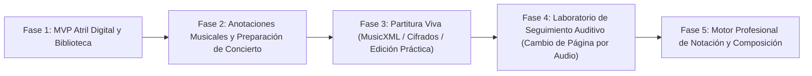

# Hoja de Ruta y Fases del Proyecto (Roadmap)

Este documento traduce la visión de **Daniel Olmos** en un plan de desarrollo por etapas, pensado para que **Daniel** (Producto y Validación Musical) y **DmnCrt88** (Project Management) puedan priorizar entregas funcionales, probarlas en la **TCL NXTPAPER 14** y en **iPad**, y controlar la complejidad técnica.

---

## Resumen de Fases

---

## Fase 1: MVP — El Atril Digital y Biblioteca Limpia
**Objetivo**: Reemplazar el uso diario básico de MobileSheets para leer partituras y armar programas de concierto con una interfaz radicalmente más limpia, rápida y adaptada a pantallas de 14" y iPad.

### Qué incluye:
1. **Lector PDF de alta velocidad a 1 y 2 páginas**:
   - Modos de papel optimizados para lectura prolongada y pantallas mate como NXTPAPER (*Papel Clásico / Crema*, *Sepia*, *Alto Contraste*, *Modo Escenario Oscuro*).
   - Recorte automático e inteligente de márgenes blancos para maximizar el tamaño del pentagrama en pantalla.
   - Navegación por toque, gesto, pedal Bluetooth estándar y *Modo Media Página* (para cambiar la página izquierda mientras sigues leyendo la derecha, o viceversa).
2. **Biblioteca Musical sin fricción**:
   - Importación de PDFs (individuales o carpetas completas) con limpieza automática de nombres de archivo.
   - Organización centrada en lo que importa: *Compositor*, *Obra*, *Instrumento/Agrupación*, *Etiquetas rápidas* y *Búsqueda instantánea*.
   - Navegador de libros grandes (como el PDF de 307 páginas que aparece en las capturas de Daniel) con índice de obras/marcadores internos para no perder una sonata dentro de un libro de obras completas.
3. **Programas de Concierto (Setlists)**:
   - Creación visual de programas (ej. *"Bach Programa"*, *"Duo Toño"*) arrastrando obras, con cálculo opcional de duración del programa y notas de concierto.

---

## Fase 2: Anotaciones Musicales y Ergonomía en Estudio/Ensayo
**Objetivo**: Hacer que anotar digitaciones, arcos, cejillas o indicaciones de ensayo sea tan natural como usar lápiz sobre papel, sin barras de 24 íconos que tapen la música.

### Qué incluye:
1. **Anotación instantánea con Lápiz Óptico (Stylus) y Dedo**:
   - Reconocimiento automático de lápiz (escribir directamente sobre el compás sin abrir menús complejos, mientras el dedo sigue pasando páginas).
2. **Paleta de Símbolos Musicales Específicos**:
   - Sellos limpios y escalables: digitación de guitarra (`p`, `i`, `m`, `a`, `1`, `2`, `3`, `4`, cuerdas `①–⑥`, números romanos de posición/cejilla `I–XII`), articulaciones, arcos para violín/cuerdas, dinámicas, calderones y gafas de atención.
3. **Capas de Anotación (Estudio vs. Concierto)**:
   - Poder encender o apagar capas (por ejemplo: ocultar notas analíticas densas el día del concierto y dejar solo recordatorios visuales clave).
4. **Herramientas integradas de estudio**:
   - Metrónomo visual y auditivo discreto, afinador rápido y reproductor de audio de referencia vinculado a la obra.

---

## Fase 3: Partitura Estructurada ("Partitura Viva") y Formatos Diversos
**Objetivo**: Ir más allá del PDF estático (que para la tablet es solo una foto) e incorporar formatos donde la aplicación **entiende qué notas, compases y acordes están escritos**. Esto sirve a músicos de distintos géneros y es el puente indispensable para la edición y para el seguimiento por audio.

### Qué incluye:
1. **Soporte para MusicXML, MXL y Cifrados/Acordes (ChordPro / Lead Sheets)**:
   - Renderizado limpio de partituras digitales donde el usuario puede cambiar el tamaño del pentagrama (redistribuyendo los compases automáticamente sin deformar la imagen), transponer tonalidades al instante o cambiar entre notación estándar y tablatura.
2. **Edición rápida en ensayo ("Micro-edición")**:
   - Antes de construir un Sibelius/Dorico completo, permitir lo que un músico necesita resolver en 30 segundos durante un ensayo: corregir una nota errónea, cambiar una alteración, ajustar una digitación tipográfica, mover un salto de sistema incómodo para evitar un mal cambio de página, o transportar una pieza para cantante/instrumento acompañante.

---

## Fase 4: Laboratorio de Seguimiento Auditivo (Cambio de Página por Audio)
**Objetivo**: Investigar, prototipar y validar gradualmente el cambio de página automático escuchando al instrumento en vivo a través del micrófono de la tablet.

### Retos técnicos reales a considerar:
- Un PDF escaneado no contiene información digital de qué notas suenan en cada compás; en cambio, una partitura MusicXML/MIDI sí la tiene.
- En la interpretación real hay **rubato**, pausas expresivas, cambios de tempo, repeticiones (con o sin *Da Capo* / casillas 1 y 2), acordes arpegiados, armónicos y ruido en la sala de ensayo.

### Plan de pruebas graduales:
- **Etapa 4A (Seguimiento sobre Partitura Estructurada / MusicXML)**:
  - Probar el algoritmo de alineación de audio en tiempo real (*Audio-to-Score Alignment / Dynamic Time Warping*) con obras en formato MusicXML tocadas en guitarra sola en ambiente de estudio.
  - Mostrar un indicador visual discreto de por qué compás detecta la app que vas, y disparar el cambio de página (o media página) unos compases antes del final de la hoja.
- **Etapa 4B (Sincronización de PDFs mediante lectura óptica u OMR / Audio de referencia)**:
  - Para PDFs tradicionales, probar dos caminos:
    1. Reconocimiento óptico musical (OMR) ligero que identifique los sistemas y notas principales del PDF.
    2. **"Entrenamiento en estudio"**: Tocar la pieza una vez en casa pasando las páginas con pedal o toque mientras la app graba la huella sonora de en qué momento cambias cada página, y luego usar esa huella en vivo para cambiar la página sola cuando reconozca ese pasaje.
- **Etapa 4C (Pruebas de estrés musical)**:
  - Evaluar comportamiento ante repeticiones, *ossias*, errores de lectura, *rubato* amplio y ensambles (dúo, música de cámara, guitarra con orquesta) con un modo de seguridad donde el músico siempre pueda intervenir con un toque o pedal si el ambiente es demasiado ruidoso.

---

## Fase 5: Motor Profesional de Creación y Edición de Partituras
**Objetivo**: Integrar capacidades avanzadas de escritura, composición, arreglo y maquetación musical (comparables en calidad gráfica y profundidad con *Dorico* o *Sibelius*), pero diseñadas para fluir tanto con pantalla táctil y lápiz óptico en tablet como con teclado/MIDI.

### Estrategia propuesta:
- En lugar de intentar programar desde cero el 100% de las reglas tipográficas de un motor como Dorico en la primera versión, construir sobre estándares abiertos de grabado musical de alta calidad (por ejemplo, motores basados en **Verovio / MuseScore Engraving / VexFlow / SMuFL**) e ir ampliando las herramientas de entrada (teclado en pantalla, diapasón de guitarra interactivo, escritura con stylus, teclado MIDI) paso a paso según las prioridades de los músicos.

---

## Próximos Pasos para Revisión (Daniel + DmnCrt88)

1. **Revisión de alcance del MVP (Fase 1)**: Confirmar si están de acuerdo con el corte de la Fase 1.
2. **Prototipo interactivo de interfaz**: Construir una maqueta visual interactiva (pensada para las proporciones de la **TCL NXTPAPER 14**) donde Daniel pueda ver y probar cómo se sentiría la nueva Biblioteca y el nuevo Lector comparado con sus capturas de MobileSheets.
3. **Elección de tecnología multiplataforma (Android + iPadOS)**: Evaluar con `@DmnCrt88` la pila tecnológica más conveniente (por ejemplo, **Flutter** o **React Native / Web híbrida con motor nativo**) para garantizar 60–120 fps al pasar páginas en Android (TCL NXTPAPER 14) y iPad desde una misma base de código.
