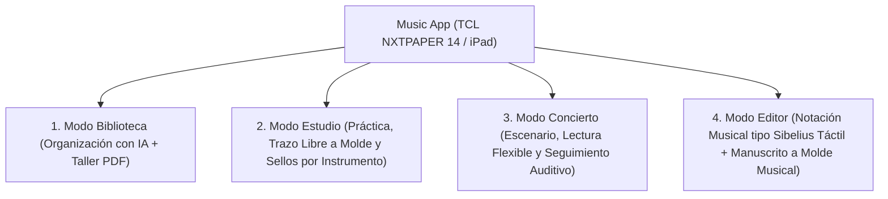

# Arquitectura de Experiencia Musical: Los 4 Modos de la Aplicación

Este documento define las especificaciones centrales de diseño y experiencia de usuario (UX) establecidas por **Daniel Olmos**, orientadas a superar las limitaciones de *MobileSheets* y de los editores de escritorio tradicionales al trabajar en tablets de gran formato (**TCL NXTPAPER 14** e **iPad**).

---

## Visión General: 4 Modos Dedicados

En lugar de saturar una sola pantalla con decenas de íconos simultáneos, la aplicación organiza el flujo del músico en **4 modos especializados** accesibles desde un selector superior limpio:

---

## 1. Modo Biblioteca (Organización Inteligente + Taller de PDF)

Diseñado para resolver el caos real de las bibliotecas digitales de los músicos (archivos con nombres como `0000040517.pdf`, páginas sueltas `01.pdf, 02.pdf` o libros escaneados de 300 páginas que contienen decenas de obras distintas).

### Capacidades Clave:
1. **Taller de PDF Integrado (Editor de Estructura Documental)**:
   - **Partición / División de PDFs**: Extraer una obra o un movimiento específico de un libro grande (ej. separar las páginas 27 a 36 de un libro de 307 páginas como una obra independiente) con un par de toques.
   - **Quitar, agregar y reordenar páginas**: Eliminar portadas en blanco, insertar una página de *ossia* o unir movimientos sueltos (`01`, `02`, `03`) en una sola partitura continua.
   - **Renombrado instantáneo y búsqueda ultrarrápida** dentro de la tablet.
2. **IA Musical Integrada de Catalogación**:
   - Analiza el nombre del archivo y la portada/primera página de la partitura para clasificar y etiquetar automáticamente sin que el músico tenga que llenar formularios interminables.
   - **Dimensiones de organización automática**:
     - **Por Compositor** (ej. *J. S. Bach*, *Leo Brouwer*, *Manuel M. Ponce*).
     - **Por Periodo Histórico** (*Renacimiento*, *Barroco*, *Clasicismo*, *Romanticismo*, *Moderno / Siglo XX*, *Contemporáneo*).
     - **Por Dotación Instrumental** (*Guitarra sola*, *Dúo*, *Música de cámara*, *Solista con orquesta*, *Ensamble*, *Piano*, etc.).
     - **Por Orden Alfabético, Programas de Concierto (Setlists) y Colecciones**.

---

## 2. Modo Estudio (Práctica, Agógica y Anotación Especializada)

En este modo toda la aplicación se adapta al trabajo diario de práctica, análisis musical y docencia.

### Capacidades Clave:
1. **Prioridad al Trazo Libre y Marcador**:
   - Escritura inmediata y sin latencia con lápiz óptico (*Stylus*) o dedo, junto con resaltadores de color translúcidos para marcar voces, entradas o secciones críticas.
2. **Transición de Trazo Libre a Texto y Símbolo Digital de Molde**:
   - Cuando el músico escribe a mano sobre la partitura indicaciones de **agógica, dinámicas, carácter o digitaciones** (ej. *"poco rit."*, *"a tempo"*, *"dolce"*, *"sul tasto"*, `"mf"`, reguladores `< >`), el detector inteligente ofrece o convierte automáticamente el trazo manuscrito en **tipografía musical limpia de molde** (estilo edición impresa), manteniendo la partitura clara y legible.
3. **Biblioteca de Sellos Especializados por Instrumento**:
   - La paleta de sellos se adapta al perfil instrumental seleccionado por el músico:
     - **Guitarra Clásica / Cuerda Pulsada**: Mano derecha (`p`, `i`, `m`, `a`), mano izquierda (`1`, `2`, `3`, `4`), cuerdas (`①` a `⑥`), cejillas y medias cejillas (`C.I` a `C.XII`, `½C`), campanelas, armónicos (`arm. 12`, `oct.`), rasgueos y golpes.
     - **Cuerdas Frotadas (Violín, Viola, Cello, Contrabajo)**: Arco abajo (`∏`), arco arriba (`∨`), posiciones en números romanos, *pizzicato*, *arco*, armónicos y digitaciones.
     - **Piano / Teclados**: Digitaciones `1-5`, marcas de pedal (`Ped.`, `*`), redistribución de manos (`m.d.`, `m.i.`).
     - **Alientos y Canto**: Respiraciones (`,`), fraseos, llaves/posiciones y articulaciones.
     - **Universal (Todos los músicos)**: Agógica, dinámicas (`ppp` a `fff`), reguladores, articulaciones, calderones y gafas de atención.

---

## 3. Modo Concierto (Escenario, Visualización Flexible y Seguimiento Auditivo)

Optimizado para ensayos generales y conciertos en vivo: máxima legibilidad, cero distracciones y seguridad total en el atril.

### Capacidades Clave:
1. **Visualización Horizontal de 1 Sola Página (Modo Principal de Daniel) + Todas las Variantes**:
   - **1 Página Horizontal (Ancho Completo)**: Aprovecha las 14.3 pulgadas en orientación horizontal para mostrar el pentagrama a gran escala, con avance fluido por media página o desplazamiento vertical controlado.
   - **2 Páginas Simultáneas (`[1 | 2]`)**: Con tres modalidades configurables de cambio de página:
     - *Salto completo de 2 en 2* (`[1 | 2]` → `[3 | 4]`).
     - *Avance continuo de 1 en 1* (`[1 | 2]` → `[2 | 3]`).
     - *Media página / Limpiaparabrisas* (la página izquierda ya leída se actualiza a la página 3 mientras el músico sigue tocando la página 2 a la derecha).
   - **1 Página Vertical Completa**: Para quienes colocan la tablet en orientación retrato.
2. **Tonos de Papel para Pantalla NXTPAPER / OLED / LCD**:
   - *Sepia Clásico*, *Papel Crema Henle*, *Blanco Estudio* y *Modo Escenario Nocturno*.
3. **Seguimiento Auditivo Inteligente (Cambio de Página por Audio) + Pedal Bluetooth**:
   - Escucha activa de la interpretación relacionando el sonido con los compases para cambiar la página en el momento óptimo, con respaldo inmediato por toque o pedal.

---

## 4. Modo Editor (Notación Profesional tipo Sibelius Táctil + Manuscrito a Notación de Molde)

Un motor profesional de creación y edición de partituras con el alcance de **Sibelius**, **Dorico** o **Finale**, pero rediseñado desde cero para la ergonomía táctil (*Touch + Stylus*) de una tablet grande.

### Capacidades Clave:
1. **Transición de Trazo Libre a Notación Musical de Molde (Reconocimiento de Escritura Musical)**:
   - El músico dibuja directamente sobre el pentagrama con el lápiz óptico: cabezas de nota, plicas, corchetes, silencios, alteraciones (`♯`, `♭`, `♮`), acordes, ligaduras, claves, compases o indicaciones técnicas.
   - El motor interpreta el trazo manuscrito en tiempo real y lo convierte instantáneamente en **notación musical tipográfica grabada ("de molde")**, alineada rítmicamente en el compás, espaciada según reglas editoriales profesionales y lista para reproducirse en audio o exportarse a MusicXML/PDF.
2. **Interfaz inspirada en Sibelius optimizada para Touch**:
   - **Keypad Rítmico Táctil Flotante**: Inspirado en la velocidad del famoso *Keypad* de Sibelius, pero diseñado para el pulgar o la mano libre en la esquina de la tablet (selección rápida de figuras rítmicas, puntillos, tresillos, silencios, ligaduras y articulaciones sin abrir submenús).
   - **Selección y edición gestual**: Arrastrar una nota hacia arriba o abajo con el lápiz/dedo para cambiar su altura escuchando el sonido; encerrar en un círculo un pasaje para copiarlo, transportarlo o aplicarle una articulación/digitación automática.
   - **Soporte nativo para Notación Estándar, Tablatura vinculada y Cifrados (Lead Sheets)**.
